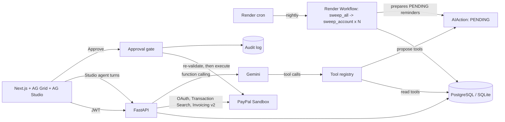

# Architecture

## AG Studio and the agent bridge
Studio's built-in agents run in the browser and execute Studio's own tools (add widget, configure chart...). Their model calls go through our adapter (`frontend/src/lib/studioAdapter.ts`) to `POST /ai/studio-turn`, where Gemini is called server-side (key never reaches the browser; auth required; payload size capped). Two PayPilot tools sit on Studio's lead agent: `list_overdue_invoices` and `queue_payment_reminder`, which only *queues* a pending action. A custom "Who owes what" widget reads invoices through Studio's `context`.

## Overnight sweep (Render Workflows)
`sweep_account(user_id)` syncs PayPal, scans anomalies and prepares a friendly reminder per overdue invoice as PENDING actions (7-day cooldown, no duplicates, nothing sent). `sweep_all()` fans it out per account, in parallel, one instance each; a cron job triggers it nightly, and **Approvals > Run sweep now** triggers it on demand. Without Render configured (or for demo-simulator users) the same code runs inline.

## The one rule
Gemini can only call a fixed registry. **Read tools** query the signed-in user's synced data. **Propose tools** create a `PENDING` action and return. The only code that touches PayPal's side-effecting endpoints is `services/actions.py`, and it runs only after a human approves.

## Approval gate (`backend/app/services/actions.py`)
`PENDING → APPROVED → EXECUTING → COMPLETED | FAILED`, plus `REJECTED` / `CANCELLED`. Each transition is a compare-and-swap `UPDATE … WHERE status = <expected>`, so a double-click or retry cannot run twice. Before executing, the payload is re-validated against the user's *current* records (an invoice paid after the proposal makes the action fail instead of sending a reminder). Failed actions are never auto-retried, because a retry could double-send.

## Why the grid reads our database
PayPal Transaction Search has a 31-day window per call, no free-text search and no sorting, and data can lag by hours. `POST /paypal/sync` pulls it (chunked into 31-day windows, all pages) into the user's tables; the AG Grid infinite row model then pages, sorts and filters on the server over that copy.

## Money handling
Revenue is completed (`S`), positive payments only. Everything is per currency; nothing is summed across currencies.

## Forecast and anomalies
Weekly revenue over completed weeks → linear trend with an approximate 95% prediction interval (≥6 weeks, ≥4 with revenue). Anomalies are explainable rules (median-baseline revenue drop, robust z-score for large payments, failure-rate spike), each with evidence IDs, reason and a suggested next step. They are flags, never fraud findings.

## Security
JWT + bcrypt; every query scoped by `user_id`; PayPal secrets Fernet-encrypted and never returned; CORS limited to `FRONTEND_URL`; login/register/chat rate-limited (in-memory, per process); webhook events are verified through PayPal before being trusted; CSV export neutralises spreadsheet formulas.
